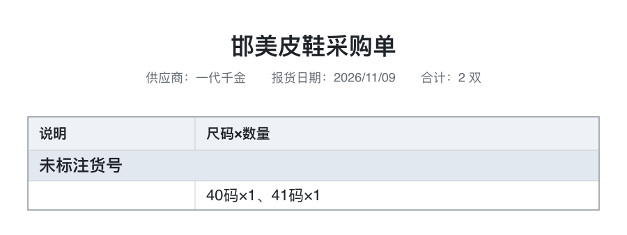
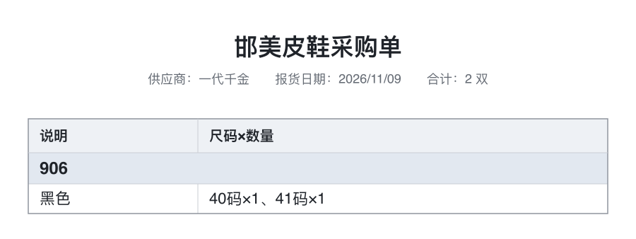

# 采购单图片「没有货号」修复 · 2026-11-09

> 业务负责人 2026-11-09 真机测试时指出：「发在群里的图片，没有货号」。

## 1. 现象

采购提交成功后，发到「邯美皮鞋运营群」的供应商采购单 PNG 里：
- 每个货号的**分组行**没有货号（显示成兜底文案「未标注货号」）；
- 颜色/尺码行仍正常（尺码×数量正确）。

数据本身没写坏：采购主表、采购明细、附件、群消息、销售明细回填都成功。

## 2. 根因

采购单图片有两条渲染路径：

| 路径 | 数据来源 | 有货号/颜色吗 |
| --- | --- | --- |
| **预渲染**（2026-10-29 并行化后默认走这条） | `posting_plan.items`（引擎冻结的**纯业务键**：货品/供应商/尺码/数量） | ❌ 没有 `item_no` / `color` / `number` |
| **现场兜底渲染** | `task.draft.items`（页面提交时已归一化的完整行） | ✅ 有 |

2026-11-09 生产真实 task 核对（只读）：

```text
posting_plan.items：12 条，plan_missing_item_no = 12
task.draft.items：  12 条，draft_missing_item_no = 0
日志：purchase.request.image.prepared · group_count=4
```

⇒ 预渲染成功时 deliver 直接使用预渲染图，于是图里没有货号；现场兜底那条路（本来就对）没被用到。

## 3. 修法

`services/purchase/documentImages.js` 的 `prepareSupplierImages`：

- 渲染前用 `task.draft.items` 按「货品记录 id + 尺码」把**展示字段**（`item_no` / `color` / `number`）合并进 plan item；
- **plan item 已冻结的字段仍优先**（不覆盖业务键）；
- `draft.items` 兼容两种形状：一个货品一条 + `entries`，或一条尺码一行；
- 只影响**出图**，不发送、不回填、不写任何表 —— 原来的「先写表、再发群」顺序不变。

## 4. 修复前后（本地渲染样例）

| 修复前 | 修复后 |
| --- | --- |
|  |  |
| 分组行「未标注货号」，且没有颜色列文本 | 分组行「906」、颜色「黑色」、尺码×数量正常 |

## 5. 判据

`test/purchaseImageParallel.test.js` 新增 **AC-IP5**：
- plan.items 缺 `item_no`/`color` ⇒ 渲染前从 `draft.items` 补上（断言 render 收到的 item 带 `item_no`/`color`）；
- plan 已冻结的 `item_no` ⇒ **不被 draft 覆盖**；
- 既有 AC-IP1/2/3（并行、不再重复渲染、失败退化）逐字不变。

## 6. 验证

- 全量：**2242 tests / 2241 pass / 0 fail**；
- `size:check`：绿；
- 未新增日志事件（`observability --check` 不受影响）；
- e2e 未跑（本次只改服务端出图数据来源，前端/接口无变化；CI 会跑）。

## 7. 边界

- **不合并、不部署**（等业务负责人验收）；
- 不改任何业务写入；生产 Base **零写入**；
- 回填「上新误报 warn」是另一件事，按业务负责人后续口径单独处理。
